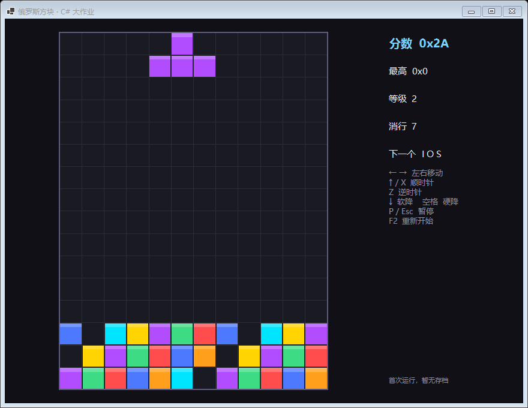

# 分工与接口契约 v1.0

> 一句话：**接口已经冻结在 `src/Tetris.Core`，三个人各自只实现自己的项目，靠 `dotnet build` 保证不互相破坏。**
> 本文件是三人之间的"合同"，改动接口必须走 §6 的流程。

---

## 0. 现在仓库里已经有什么

| 内容 | 状态 |
|---|---|
| 5 个项目 + 解决方案 | 4 个源码项目 0 警告 0 错误；测试项目需联网还原 xUnit 后 `dotnet test` |
| 公共契约（状态、规则、引擎、存档、AI 接口） | 已冻结，见 §3 |
| 契约测试 8 个 | 已全部通过（`tests/Tetris.Core.Tests`） |
| WinForms 界面骨架 | 可运行，见 `docs/界面骨架.png`（目前跑的是假引擎） |
| XML 高分存档 | 基础实现已就绪，异常场景待 B 补完 |
| JSON 配置加载、AI 算法、真引擎 | **未实现——这就是你们三个人的活** |

界面骨架长这样（假数据，用于验证渲染/布局/HUD）：



---

## 1. 三个人怎么分

贡献比合计 100%，三人不得相同；**三份报告里的这张表必须完全一致**。

| 代号 | 角色 | 主责项目 | 分支 | 贡献比 | 答辩负责回答 | 报告主写章节 |
|---|---|---|---|---|---|---|
| **A** | 核心引擎 + 架构负责人（组长） | `src/Tetris.Core` | `feat/core` | 35% | 碰撞/旋转/踢墙、状态复制、游戏循环时序 | 3.1 核心算法、4.1 性能数据 |
| **B** | 界面 / 输入 / 存档 / 稳定性 | `src/Tetris.App`、`src/Tetris.Persistence` | `feat/ui` | 33% | 渲染与逻辑解耦、DAS 去抖、XML 异常恢复 | 3.2 界面、3.3 持久化、4.2 异常场景表 |
| **C** | 扩展 AI / 测试 / 构建发布 | `src/Tetris.AI`、`tests/`、`config/`、`docs/` | `feat/ai` | 32% | 评估函数、测试设计、配置扩展点 | 3.4 扩展设计、4.3 量化数据 |

> 姓名、学号请自行填进表格后再写进报告封面。

**为什么这么分**：每个人手里都有一块"能独立演示、能被老师追问"的东西。没有"只写文档"或"只调样式"的角色，答辩时谁都不会无话可说。

---

## 2. 仓库结构与依赖方向

```
Tetris.sln
├─ src/
│  ├─ Tetris.Core/            ← A：所有契约 + 规则 + 引擎（不引用任何项目，不引用任何 UI）
│  │  ├─ GameState.cs           共享状态（全员只读）
│  │  ├─ Tetromino.cs           下落中的方块
│  │  ├─ GameConfig.cs          棋盘尺寸/重力/计分/形状
│  │  ├─ IGameRules.cs          ← C 的 AI 用
│  │  ├─ IGameEngine.cs         ← B 的界面用
│  │  ├─ IHighScoreStore.cs     ← B 实现
│  │  ├─ IPlayerAgent.cs        ← C 实现、B 调用
│  │  └─ Testing/               假引擎（B 的脚手架，A 交付后可删）
│  ├─ Tetris.Persistence/     ← B：XML 高分
│  ├─ Tetris.AI/              ← C：自动玩家
│  └─ Tetris.App/             ← B：WinForms 界面
├─ tests/Tetris.Core.Tests/   ← C：xUnit
├─ config/                    ← C：JSON 配置（待建）
└─ docs/                      ← C：报告素材、本文件
```

依赖方向（只允许箭头方向，反向一律 review 打回）：

```
Tetris.App ──→ Tetris.Persistence ──→ Tetris.Core
     └──────────────────────────────→ Tetris.Core
Tetris.AI  ─────────────────────────→ Tetris.Core
tests      ─────────────────────────→ Tetris.Core / Tetris.AI
```

三条铁律：

1. **`Tetris.Core` 不许引用任何项目**，也不许出现 `System.Windows.Forms`、`System.Drawing`、`File`、`Console`。
2. 别人只通过**接口**用你的东西，不许 `new` 你项目里的具体类（唯一例外见 §5 的接线点）。
3. 谁的目录谁改；跨目录改动先在群里说一声。

---

## 3. 接口契约

### 3.0 共享数据（A 维护，B/C 只读）

| 类型 | 位置 | 约定 |
|---|---|---|
| `GameState` | `Core/GameState.cs` | 完整一局状态。**B 只读**；**C 只能 `Clone()` 后在副本上改**；A 在引擎内部改 |
| `Tetromino` | `Core/Tetromino.cs` | 不可变：任何变换都用 `With(...)`，不要改它的属性 |
| `GameCommand` | `Core/GameCommand.cs` | 玩家"意图"（不是按键）。B 从键盘产生，C 从 AI 产生，A 消费 |
| `GameConfig` | `Core/GameConfig.cs` | 12×16、重力表、计分规则、形状数据。C 的 JSON 加载器只需产出这个类型 |
| `PieceShape` / `PieceShapes` | `Core/PieceShape.cs` | 4 个旋转态、4×4 包围盒、`'#'` 表示实心。颜色在 `ColorHex` |

关键细节（写错必返工）：

- 坐标是 **`[x, y]`**：`x` 是列、`y` 是行、`y = 0` 在**顶部**；
- 方块位置是 **4×4 包围盒左上角**，不是方块自身左上角；
- 状态必须能 `new GameState(config)` 独立创建、能 `Clone()` 深拷贝（评分点）；
- 分数在状态里是**十进制 int**，显示成十六进制是 B 的事（`$"0x{Score:X}"`）。

### 3.1 `IGameRules` —— A 实现，C 使用

```csharp
bool Collides(GameState state, Tetromino piece);   // 重叠或越界
int  DropDistance(GameState state, Tetromino piece);// 还能下落几格
bool TryMove(GameState state, int deltaX);         // 被挡住返回 false 且不改状态
bool TryRotate(GameState state, int direction);    // +1 顺 / -1 逆，含踢墙
int  LockActive(GameState state);                  // 落定+消行+计分+升级，返回消行数
```

**没有这个方法，C 就写不了 AI**：AI 靠 `Clone` + `DropDistance` + `LockActive` 推演每个落点。

### 3.2 `IGameEngine` —— A 实现，B 使用

```csharp
GameState State { get; }
void Start(int seed);                 // 开新局（清盘 + 重建方块序列）
bool Apply(GameCommand command);      // 无效操作返回 false，不抛异常
void Tick();                          // 推进固定 1/60 秒
```

- **固定步长**：`Tick()` 无参数，一帧就是 1/60 秒。B 用 `Stopwatch` 累积、按需补帧（一次最多补 3 帧）。
  好处：不同电脑手感一致、回放可复现、性能数据可比较。
- **单线程**：只在 UI 线程调用。引擎内部不许起线程、不许 `async`、不许弹窗。
- **不抛异常**：这是 15 分盲测项的底线。

### 3.3 `IHighScoreStore` —— B 实现，B 使用

```csharp
string Location { get; }
HighScoreLoadResult Load();     // 永远不抛；用 Missing/Corrupted/Unreadable 表达失败
bool Save(HighScore record);    // 失败返回 false，不抛
```

界面必须能区分四种状态：正常 / 首次运行 / 存档损坏 / 读不了（被占用、只读、无权限）。

### 3.4 `IPlayerAgent` —— C 实现，B 调用

```csharp
string Name { get; }
void Reset();                                   // 开新局
GameCommand NextCommand(GameState state);       // 每帧问一次，可返回 None
```

B 在"人机/观战"模式下每帧调用一次，把返回值交给 `IGameEngine.Apply`。
**AI 不能直接改状态**，只能返回命令——这样人机切换只换命令来源，引擎完全不用改。

### 3.5 `GameConfig` —— A 定义，C 的配置加载器产出

C 写的 `config/game.json` 读出来就是一个 `GameConfig`：

```csharp
new GameConfig { BoardWidth = 12, BoardHeight = 16, Shapes = ..., ScoreRule = ... }
```

这就是"可扩展架构"的演示路径：改棋盘尺寸、改形状、换计分规则都不动核心代码。
**注意**：新增"第 8 种方块"要改 `PieceKind` 枚举，属于核心改动，答辩时如实说明取舍。

### 3.6 线程与时间契约（三条，违反就是 P0）

1. 整个程序 **只有一个线程**（UI 线程），没有后台线程、没有 `Task.Run`、没有事件跨线程。
2. 定时器只做三件事：`Tick()` → 读 `State` → 绘图。**逻辑不写在画面里**。
3. AI 每帧预算 ≤ 8 ms（60 帧共 16.7 ms）。超了就降搜索深度，不许阻塞界面。

### 3.7 接口一览表

| 接口 | 实现者 | 调用者 | 冻结 |
|---|---|---|---|
| `IGameRules` | A | A（引擎内部）、C（AI 推演） | ✅ |
| `IGameEngine` | A | B | ✅ |
| `IHighScoreStore` | B | B、测试 | ✅ |
| `IPlayerAgent` | C | B | ✅ |
| `IRandomSource` | A（已提供 `XorShiftRandomSource`） | A | ✅ |
| `IScoreRule` | A（已提供 `StandardScoreRule`） | A、C（配置） | ✅ |

---

## 4. 文件所有权

| 路径 | 所有者 | 其他人 |
|---|---|---|
| `src/Tetris.Core/**`（除 `Testing/`） | **A** | 只读，改一行也要 A 同意 |
| `src/Tetris.Core/Testing/**` | A（临时脚手架） | 只读；A 交付后可删 |
| `src/Tetris.App/**` | **B** | 只读 |
| `src/Tetris.Persistence/**` | **B** | 只读 |
| `src/Tetris.AI/**` | **C** | 只读 |
| `tests/**`、`config/**`、`docs/**`、`README.md` | **C** | 只读 |
| `Tetris.sln`、`Directory.Build.props` | **A** | 改前先说 |

冲突规避要点：

- 每个人只在自己目录里新建文件，**不要"顺手"去改别人的文件**；
- 需要别人改，就在群里贴 `文件:行号` + 建议，由所有者改；
- `.sln` 只在新增项目时改，改完立刻提交，避免三个人各改一版。

---

## 5. 三个人今天就能开工（互不等待）

### A：规则 + 引擎

1. `StandardGameRules : IGameRules`（放 `src/Tetris.Core/Rules/`）
   - 先 `Collides` / `DropDistance` / `TryMove`（半天）
   - 再 `TryRotate`（SRS 踢墙表，5 个偏移依次试）
   - 再 `LockActive`（写盘 → 消行 → `ScoreRule.ScoreFor` → 升级）
   - **D3 前必须交付前四个方法**，C 在等这个
2. `GameEngine : IGameEngine`（放 `src/Tetris.Core/Engine/`）
   - 7-bag 洗牌（用 `IRandomSource`，每次 7 个打乱）
   - 重力累积（`GravityMsFor(Level)`）、软降、硬降、暂停、生成失败 → `GameOver`
   - 每帧 `State.Frame++`
3. 自测：固定 seed 跑 1000 帧不崩、方块不出界、消行后棋盘下移正确

### B：界面（已经能跑，接着做实）

1. 现在 `dotnet run --project src/Tetris.App` 就能看到界面（跑的是 `DemoEngine`）
2. 待做：真实输入 **DAS/ARR**（按住左右先延迟 150ms、再每 40ms 重复）、
   "下一个方块"改画成图形预览、暂停/结束覆盖层、窗口缩放/DPI 下的布局、
   **8 条异常场景表**（见 §7）
3. **A 交付引擎后，改 `AppBootstrap.CreateEngine` 一行** + 删掉 `DemoEngine` 的 `using`，跑通即完成接线

### C：AI + 测试 + 发布

1. AI（`src/Tetris.AI/HeuristicAgent.cs` 已占位）
   - 先写评估：列高、空洞数、凹凸度、消行数，加权打分
   - 再写推演：对 (4 旋转 × 12 列) 逐个 `Clone` → `DropDistance` → `LockActive` → 打分取最优
   - 每块只规划一次，逐帧下发 `MoveLeft/Right`、`RotateCw`、`HardDrop`
   - **A 的 `IGameRules` 没到位之前**，用测试里的假 `IGameRules` 先跑通算法
2. 测试从 8 个补到 **15 个以上**：碰撞（越界/重叠）、旋转（踢墙）、消行（1-4 行）、计分、等级、状态复制
3. JSON 配置加载器 + `config/game.json`（对应 §3.5）
4. `dotnet publish`、README、演示视频脚本（含一次删存档的异常演示）

**联调节奏**：D3 A 交规则 → C 接真规则；D5 A 交引擎 → B 接线；D6 三人跑通一局。

---

## 6. 协作流程

### 6.1 分支与提交

```
main            始终可 build 可运行
feat/core        A
feat/ui          B
feat/ai          C
```

- 每次合并前：`dotnet build Tetris.sln` 0 错误 + `dotnet test` 全绿 + 不动别人文件
- 提交信息：`feat(core): 实现 SRS 踢墙`、`fix(ui): 修复窗口缩小时除零`
- **每天至少一次小提交**。要求 ≥12 次、≥4 个不同日期，别最后一天合并（老师明确不收一次性提交）

### 6.2 改接口的流程（只有这一条路）

1. 群里说明：为什么改、影响谁；
2. A（或负责人）同意后，**当天**改完接口 + 所有调用点；
3. 全员 `git pull` 后重新 `dotnet build`；
4. 谁没改完谁负责，不许"先合并再说"。

**D10 之后接口冻结**，只能加不改。

### 6.3 例会

每周两次、每次 30 分钟：各自演示 5 分钟 → 说卡点 → 定下一个交付时间。
A 每周做一次 15 分钟 code walkthrough（讲碰撞与状态复制），B、C 必须能复述。

---

## 7. 联调与验收清单

### 命令

```bash
dotnet build Tetris.sln
dotnet test
dotnet run --project src/Tetris.App
dotnet publish src/Tetris.App -c Release -r win-x64 --self-contained false -o publish
```

### 接线检查（D6 之后每次合并都查）

- [ ] `AppBootstrap.CreateEngine` 已经不用 `DemoEngine`
- [ ] `grep -r "DemoEngine" src/` 结果为空（或只剩 `Testing/`）
- [ ] 固定 seed 下两次运行的方块序列一致

### 异常场景（B 主责，三人分头手测，报告 4.2 直接用这张表）

| # | 场景 | 期望 |
|---|---|---|
| 1 | 删除存档后启动 | 正常开局，显示"暂无存档" |
| 2 | 存档写入乱码 | 不崩溃，按"损坏"处理并忽略 |
| 3 | 存档设为只读 | 开局正常，保存失败有提示 |
| 4 | 另一进程独占存档 | 不崩溃、不假死 |
| 5 | 拖动改变窗口大小 / 最大化 | 棋盘等比缩放不糊、不闪 |
| 6 | 疯狂连按左右+旋转+空格 | 不重复触发、不掉帧 |
| 7 | 两个方向键同时按 | 行为确定（后按优先或同时抵消，二选一并写进报告） |
| 8 | Alt+Tab / 最小化再恢复 | 计时不错乱、不瞬移多个方块 |

### 量化数据（报告必须有一项，§4.3）

- A：单帧逻辑耗时（`Stopwatch` 包住 `Tick`，跑 10000 帧取 p99）
- B：异常场景通过数 / 8
- C：AI 平均得分、测试数量与覆盖率

---

## 8. 答辩与报告

### 8.1 每人 3 分钟 + 一个小改动

| 人 | 讲什么 | 现场改什么（提前排练） |
|---|---|---|
| A | 碰撞、旋转踢墙、状态复制 | 改 `config/game.json` 把棋盘从 12×16 改成 10×20 |
| B | 循环/输入/存档异常 | 当场删存档、把存档改成乱码，重启演示 |
| C | 评估函数、测试 | 换一个计分规则实现，展示"核心代码不动" |

### 8.2 报告（每人独立交，3000–5000 字）

- 封面页的三行"学号/姓名/分工/贡献比"三份必须一致
- 第三章：各写自己的 3.x
- 第四章：各写自己的量化数据
- **第五章反思必须各写各的**（调试过程、AI 用在哪里、AI 哪里出错被你改掉）——这是查重高发区
- 摘要、引言、结论各自重写，不要互相复制

---

## 9. 一页速查

```csharp
// B：界面怎么用引擎
_engine.Start(seed);
var cmd = KeyMap.ToCommand(e.KeyCode);
if (cmd is not null) _engine.Apply(cmd.Value);
_engine.Tick();                    // 每 1/60 秒一次
var s = _engine.State;             // 只读

// C：AI 怎么推演（不要改原状态！）
var sim = state.Clone();
var piece = state.Active.With(rotation: 2);
var y = rules.DropDistance(sim, piece);
sim.Active = piece.With(y: piece.Y + y);
var cleared = rules.LockActive(sim);

// A：引擎内部怎么用规则
if (!_rules.TryMove(State, dx)) return false;
```

| 我该动哪 | 项目 |
|---|---|
| 规则/引擎/契约 | `src/Tetris.Core` |
| 画面/按键/存档 | `src/Tetris.App`、`src/Tetris.Persistence` |
| AI/测试/配置/文档 | `src/Tetris.AI`、`tests`、`config`、`docs` |
